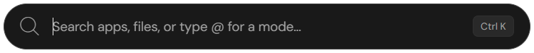
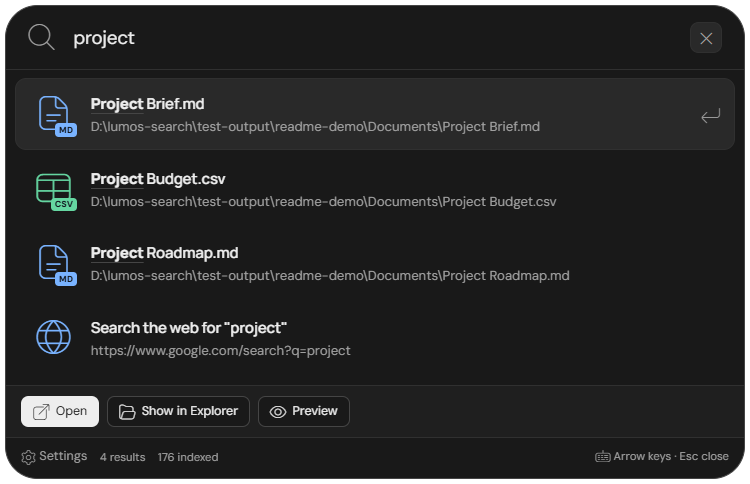
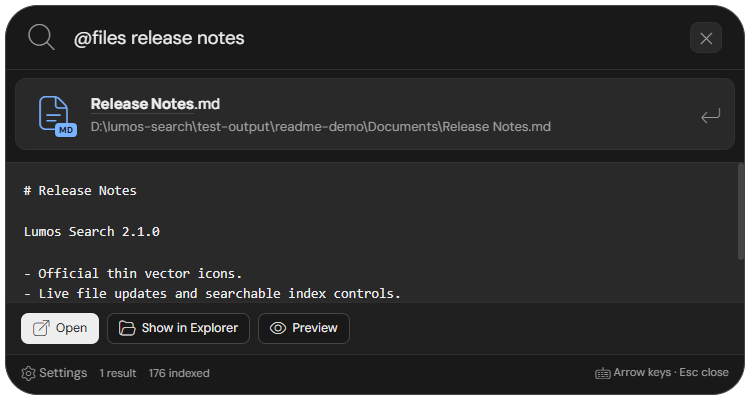
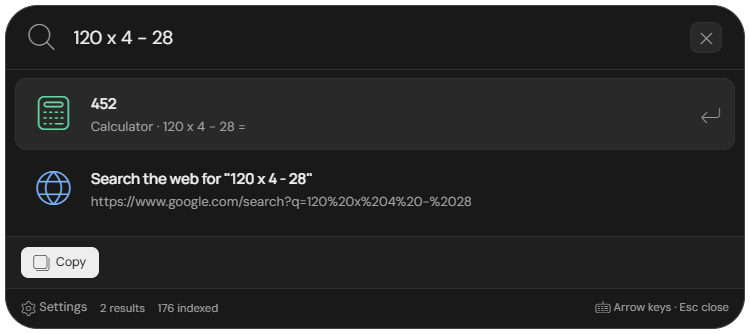
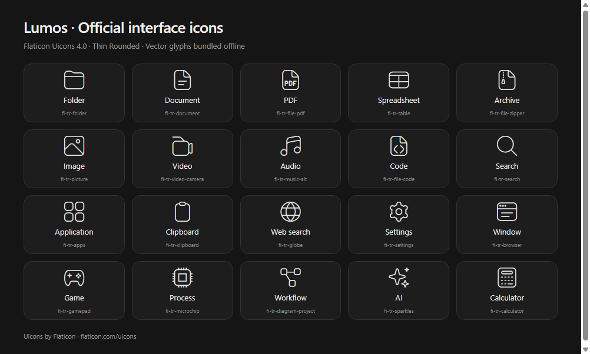
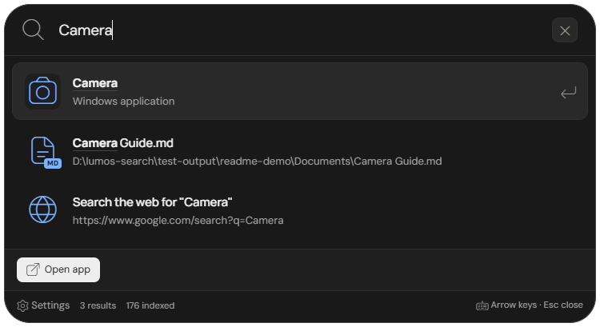
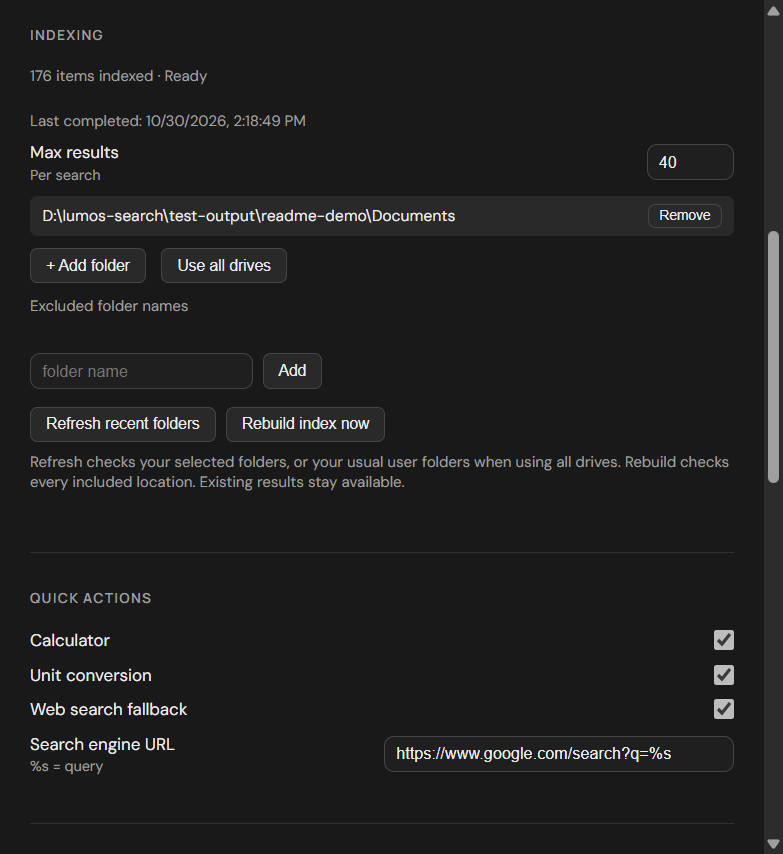
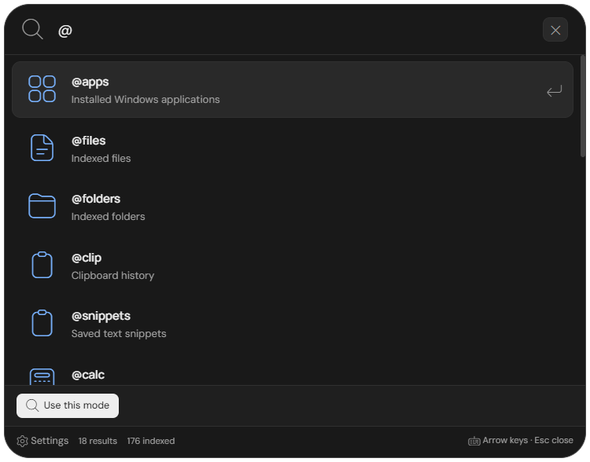

<h1 align="center">Lumos Search</h1>

<p align="center">
  <strong>Apps, files, and everyday commands. One search bar.</strong><br>
  A compact Windows launcher with a dark interface, official thin vector icons, live indexing,<br>
  and results that expand smoothly beneath your search.
</p>

<p align="center">
  <kbd>Alt</kbd> + <kbd>,</kbd> to open · <kbd>Alt</kbd> + <kbd>X</kbd> also works<br>
  <sub>v2.1.0 · Windows desktop · Electron + React</sub>
</p>

<p align="center">
  <a href="#see-it-in-action">See it in action</a> ·
  <a href="#refresh-and-reindex">Refresh and reindex</a> ·
  <a href="#use-lumos-to-its-full-potential">Full usage guide</a> ·
  <a href="#run-locally">Run locally</a> ·
  <a href="#keyboard-controls">Keyboard controls</a> ·
  <a href="https://github.com/starsailor2/lumos-search/releases">Releases</a>
</p>

---

## See it in action

These are real, unedited captures of the running Windows app. The examples use sample documents in an isolated profile; the results, calculator output, and file preview are produced by Lumos itself.

### 01 — A small place to start

Press your global shortcut to bring up the pill. Start typing without opening a separate search page.

<p align="center">
  
</p>

### 02 — Results expand beneath your query

Type a word such as `project`. Matching documents appear directly below the same input. The panel grows to fit the results, keeps its top edge in place, and scrolls when the list gets longer.

<p align="center">
  
</p>

### 03 — Find a file. Check its contents.

Use `@files release notes` to narrow the search to files, then choose **Preview**. Read a text preview, open the document, or reveal it in Explorer from the same panel.

<p align="center">
  
</p>

### 04 — Calculate while you search

Enter `120 x 4 - 28` and Lumos returns **452**. Choose **Copy** to use the answer elsewhere. Unit conversions such as `5 km to mi` work from the same input.

<p align="center">
  
</p>

## What you can do

| Task | Built into the launcher |
| --- | --- |
| Find your work | Search indexed apps, files, and folders; preview supported text files; open or reveal results. |
| Handle small tasks | Calculate, convert units, find emoji, and paste saved snippets. |
| Pick up where you left off | Browse clipboard history, favourites, and recent launches. |
| Reach the web | Open keyword quicklinks or send a query to your configured search engine. |
| Control your workspace | Find open windows, snap a window, browse processes, and run system commands. |
| Launch and automate | Find Steam/Epic library entries and run configured workflows. |
| Ask or extend | Configure your own AI endpoint and key, or add local search extensions. |

The index follows ordinary file creation, rename, and deletion events, with periodic scans as a recovery mechanism. File matching runs in a worker; fast results can appear while slower search sources finish. Existing results remain available during rebuilds. Typography uses bundled **DM Sans** and **Manrope**.

### Official thin vector icons

The interface uses **Flaticon Uicons 4.0 · Thin Rounded** for search, files, folders, media, commands, action buttons, and keyboard hints. Recognized applications use matching thin symbols or Flaticon's vector brand glyphs. Other apps use the thin application symbol. File-type colors remain subtle accents against the dark interface. Both vector fonts are bundled locally: no bitmap placeholders or runtime CDN requests are needed. Actual emoji search results remain emoji characters.

<p align="center">
  
</p>

**Uicons by [Flaticon](https://www.flaticon.com/uicons).** Used under the [Flaticon License](src/assets/icons/Flaticon-LICENSE.txt), with attribution in Settings and this README. The [icon manifest](src/assets/icons/uicons.json) records the official style, semantic mappings, version, and font checksums. These third-party assets retain their own license.

### Open Windows applications

Type an app name such as `Camera`, `WhatsApp`, or `Calculator`, select it, and press **Enter**. Matching applications appear first, followed by files, folders, and other results. Relevance and usage history still determine the order within each group. Lumos combines indexed Start-menu shortcuts with Windows' registered-app list, including Microsoft Store apps. `File Manager` also finds Windows File Explorer. Use `@apps` to focus the search on applications; `@files`, `@folders`, and direct path queries keep their focused behavior.

Normal app launching does **not** require running Lumos as administrator. Windows handles any elevation prompt required by the target application. App discovery uses [Get-StartApps](https://learn.microsoft.com/en-us/powershell/module/startlayout/get-startapps?view=windowsserver2025-ps) for the current user's installed applications.

<p align="center"></p>

## Refresh and reindex

**Rebuild everything:** open **Settings → Indexing → Rebuild index now**, or type **`reindex`** in the search bar and run **Rebuild Index**. The tray menu has the same action.

**Check recent changes:** type **`refresh index`** and choose **Refresh recent folders**. This checks your selected roots; with the all-drives default, it checks Desktop, Documents, Downloads, Pictures, Videos, and Music. A full rebuild checks every included location.

Click the **index status in the search footer** to open Indexing settings directly. It shows indexed items, items found during the current scan, elapsed scan time, the last completed scan, queued work, and unreadable locations. Use **Add folder** and the exclusions list to control what is included.

<p align="center"></p>

Changes are batched instead of starting a scan for every event. Scheduled recovery checks run about every five minutes for common folders, with an hourly full scan when Windows has been idle for at least five minutes. Timing depends on scan duration and location availability. Folder watching may miss events on some filesystems; use refresh or rebuild when needed. Existing entries under an unreadable location are retained, so disconnected-drive results may remain unavailable until the drive returns.

## Run locally

**Requirements:** Windows, Git, and Node.js **22.12 or newer** with npm.

```powershell
git clone https://github.com/starsailor2/lumos-search.git
cd lumos-search
npm ci
npm start
```

`npm start` builds the React interface and starts Electron. Lumos runs in the system tray; use **Alt+,** or **Alt+X** to open it. If a shortcut is already registered by another app, Lumos tries its configured fallbacks. The tray also provides **Show search**, **Settings**, and **Quit**.

For a useful first run, open **Settings → Indexing**, choose your working folders, and let the initial scan complete. Try `Camera`, `@files budget`, `@folders projects`, `120 x 4 - 28`, and `5 km to mi`. You can continue searching while indexing runs.

### Build a Windows installer

```powershell
npm run dist
```

The installer is written to `release/`. Generated installers are not committed to the repository. Published builds, when available, are listed on the [Releases page](https://github.com/starsailor2/lumos-search/releases). Local builds are unsigned unless a signing certificate is configured.

## Keyboard controls

| Key | Action |
| --- | --- |
| **Alt+,** / **Alt+X** | Show or hide Lumos globally. |
| **Type** | Search and expand matching results beneath the pill. |
| **Ctrl+K** | Toggle the suggestions panel. |
| **↑ / ↓** | Move through results. |
| **Enter** | Run the selected result's primary action. |
| **Shift+Enter** | Run its secondary action, when available. |
| **Tab / Shift+Tab** | Move between available buttons. |
| **Escape** | Clear the query and collapse results; press again to hide the launcher. |

Clearing the input returns the launcher to its compact pill. The input stays in place during expansion and collapse. Reduced-motion preferences and the animation setting are respected.

## One input, optional search modes

Search normally to combine providers, or type an `@` prefix to focus on a particular kind of result.

Type **`@`** to see available modes. Start a prefix such as **`@fi`**, select **@files**, and press **Enter** to put the mode in the same input.

<p align="center"></p>

| Mode | Example |
| --- | --- |
| Apps, files, folders | `@apps code` · `@files release notes` · `@folders projects` |
| Clipboard and snippets | `@clip` · `@snippets` |
| Emoji | `@emoji happy` |
| Calculator and units | `@calc 120 x 4 - 28` · `@convert 5 km to mi` |
| Quicklinks and web | `@links` · `@web documentation` |
| Recent items and favourites | `@recent` · `@fav` |
| Windows and processes | `@windows` · `@process` |
| System commands and games | `@system` · `@games` |
| Workflows and AI | `@workflows` · `@ai explain recursion` |

AI is optional and disabled by default. Configure its endpoint, model, and API key in **Settings** before using it.

## Use Lumos to its full potential

### Find, open, and preview

Normal searches place matching applications first. Use `@files` or `@folders` to focus on your work. Words can match both a file name and its parent folder: `@files projects budget` can find a budget inside a Projects directory. Direct path queries such as `C:\Projects\report` retain relevance ordering. `cd projects` offers navigation to a matching indexed folder in Explorer.

Select a result and use **Open**, **Show in Explorer**, or another available action. **Enter** runs the primary action; **Shift+Enter** runs the secondary action when available.

**Preview** appears for supported text files: TXT, Markdown, JSON, LOG, CSV, JS, TS, Python, YAML, XML, INI, CFG, and CONF. It displays the first 2,000 characters of files up to 2 MB. PDF, Office, image, and video previews are not currently provided; open those formats in their associated applications.

### Calculator and units

Type arithmetic directly: `2x3`, `(18 + 6) / 3`, or `2^3`. Choose **Copy** to use the answer elsewhere. `@calc` restricts results to the calculator. Conversions include examples such as `5 km to mi`, `100 cm to m`, and `-40 C to F`; use `@convert` to focus conversions.

### Clipboard and snippets

- `@clip` browses clipboard history; `@clip invoice` filters saved text. Text entries offer Paste and Copy. Image entries offer Copy.
- **Settings → Clipboard history** controls capture, history size, persistence across restarts, and clearing saved entries.
- In **Settings → Snippets**, add a trigger and body, such as `;intro` and a reusable introduction. Search the trigger, or browse with `@snippets`, then choose Paste or Copy. Paste targets the previously focused application; elevated apps may require additional Windows permissions.

### Quicklinks and web search

In **Settings → Quicklinks**, add a keyword, title, and full URL. For example: keyword `docs`, title `Project documentation`, URL `https://example.com/docs`. Search `docs`, or browse with `@links`. Quicklinks are saved URLs; they do not substitute query parameters.

Choose a web-search result to open your configured browser. `@web your question` focuses web-related results. The web-search URL configured in Settings uses `%s` for the encoded query; merely typing a query does not open the browser.

### Your Windows workspace

| Search | What you can do |
| --- | --- |
| `@windows` | Browse open windows and focus one. |
| `Snap Window Left` / `Snap Window Right` | Arrange the previously focused window. |
| `@system` | Browse Windows settings, volume, lock, power, and index commands. |
| `@process notepad` | Find running processes and their reported memory use. |
| `@games` | Search discovered Steam and Epic libraries. |
| `@emoji happy` | Find and copy actual emoji characters. |
| `@recent` | Return to recent launches. |
| `@fav` | Browse configured favourites. |

Shutdown, restart, emptying the Recycle Bin, and stopping a process require confirmation. Game discovery depends on library locations and an installed launcher. Not every native integration has been tested on every machine.

### Optional AI

In **Settings → AI**, configure a compatible endpoint, model, and API key, then enable AI. Use `@ai explain recursion` and choose **Ask AI**. A successful answer remains readable in the launcher and is copied to the clipboard. Errors are shown instead of being presented as answers. Selecting the AI action sends the prompt to your configured endpoint and may incur that provider's charges; search suggestions themselves do not call the AI service.

### Favourites, workflows, and extensions

Favourites and workflows currently use configuration entries rather than a visual editor. Type **`data folder`** and choose **Open Lumos data folder**, or use **Settings → Usage data → Open data folder** to find the exact location. Quit Lumos from its tray menu, back up `config.json`, and edit the relevant arrays while preserving the rest of your configuration.

<details>
<summary><strong>Example favourites and a two-step workflow</strong></summary>

Replace the paths with existing locations on your PC. These are fields to merge into your configuration, not a complete replacement file:

```json
{
  "favourites": [
    { "path": "D:\\Projects", "title": "Projects", "kind": "folder" }
  ],
  "workflows": [
    {
      "id": "daily-work",
      "name": "Start daily work",
      "trigger": "daily",
      "steps": [
        { "action": "open", "data": { "path": "D:\\Projects" } },
        { "action": "copy", "data": { "text": "Today's priorities:" } }
      ]
    }
  ]
}
```

Restart Lumos, then use `@fav` or `@workflows daily`. Workflows currently support sequential **open** and **copy** steps. A failed open stops execution and shows an error.

</details>

Extensions live under `extensions/` in the data folder. Each extension has `manifest.json` and `index.js`; see [the working Lorem Ipsum example](extensions/sample-lorem/). Restart Lumos after changing extensions. Install extensions you trust: deadlines and worker memory limits protect responsiveness, but they do not make arbitrary plugin code safe.

The advanced `copy paths` command copies up to the first 20 indexed file/folder paths as newline-separated text. It does not copy the current search selection.

### When a result is missing

Check the included roots and exclusions in **Index settings**, then try refresh or rebuild. Reconnect an unavailable drive first. For an application, check that Windows registers it or that it has an indexed Start-menu shortcut; the application catalog refreshes in the background. If the global shortcut stops working, open Lumos from the tray and change its hotkeys or fallbacks.

## Settings and local data

Open **Settings** from the tray or the expanded panel's footer. Configure hotkeys, indexed folders and exclusions, result limits, appearance, clipboard retention, snippets, quicklinks, and AI.

- The file index, configuration, and usage data are stored locally in Electron's user-data directory.
- Clipboard history can be disabled or cleared. Keeping it across restarts is configurable.
- Web search opens your browser when you choose that action. AI requests go to the endpoint you configure.
- Local extensions run in separate workers with deadlines and memory limits. Install extensions you trust.

Local configuration and retained clipboard data are currently ordinary files without application-level encryption. Treat the data folder as private and disable clipboard persistence when appropriate. OS-backed secret storage remains planned; this release does not claim that protection.

See [the audit and verification notes](AUDIT.md) for tested behavior and the remaining native-integration checks.

## Development

| Command | Purpose |
| --- | --- |
| `npm run build` | Build the React launcher. |
| `npm run dev` | Rebuild the UI when source files change. |
| `npm start` | Build and run Electron. |
| `npm test` | Run regression tests. |
| `npm run typecheck` | Check TypeScript types. |
| `npm run test:smoke` | Exercise the app through native Electron input with an isolated profile. |
| `npm run test:benchmark` | Compare matching, worker responsiveness and memory at 100,000 and one million entries. |
| `npm run dist` | Build the Windows installer. |

<details>
<summary><strong>Project layout</strong></summary>

```text
src/main.js                 Electron lifecycle, IPC, indexing, and actions
src/indexer.js              Background file crawler
src/folder-watch.js         Batched change monitoring and reconciliation
src/file-search*.js         Worker-backed file matching
src/providers/              File, clipboard, calculator, and command providers
src/launcher/               React search interface
src/shared/                 Renderer types and hooks
src/styles/                 Theme tokens and bundled font declarations
src/assets/fonts/           Local fonts and their licenses
src/assets/icons/           Official vector fonts, manifest and Flaticon license
extensions/sample-lorem/    Example extension
scripts/capture-readme.cjs  Real-app screenshot capture
docs/screenshots/           Real app screenshots and icon collection
tests/                      Regression, smoke, benchmark, and package checks
```

</details>

<details>
<summary><strong>Refresh the README screenshots</strong></summary>

After installing dependencies:

```powershell
npm run build
npx electron scripts/capture-readme.cjs
npx electron scripts/preview-icons.cjs
```

The capture script opens the real launcher, types the example searches, checks the results, and captures normal search, expanded results, preview, calculator, app priority, modes, and live index settings. It uses an isolated temporary profile, disables clipboard capture for that profile, and creates sample documents under the ignored `test-output/readme-demo/` directory. The icon preview script renders the same local vector fonts the app uses.

</details>

## License

[MIT declaration for application code](package.json). Bundled DM Sans and Manrope include their [SIL Open Font License notices](src/assets/fonts/). Uicons and brand glyphs use the [Flaticon License](src/assets/icons/Flaticon-LICENSE.txt); brand names and marks belong to their respective owners. See [IMPROVEMENTS.md](IMPROVEMENTS.md) for the remaining improvement sequence.
