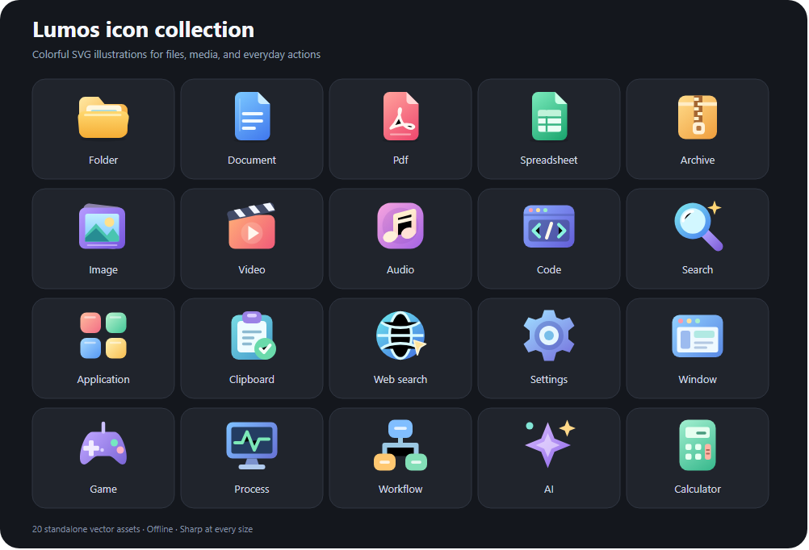

<h1 align="center">Lumos Search</h1>

<p align="center">
  <strong>Apps, files, and everyday commands. One search bar.</strong><br>
  A compact Windows launcher with a dark interface, colorful icons, local indexing,<br>
  and results that expand smoothly beneath your search.
</p>

<p align="center">
  <kbd>Alt</kbd> + <kbd>,</kbd> to open · <kbd>Alt</kbd> + <kbd>X</kbd> also works<br>
  <sub>v2.0.5 · Windows desktop · Electron + React</sub>
</p>

<p align="center">
  <a href="#see-it-in-action">See it in action</a> ·
  <a href="#run-locally">Run locally</a> ·
  <a href="#keyboard-controls">Keyboard controls</a> ·
  <a href="https://github.com/starsailor2/lumos-search/releases">Releases</a>
</p>

---

## See it in action

These are real, unedited captures of the running Windows app. The examples use sample documents in an isolated profile; the results, calculator output, and file preview are produced by Lumos itself.

### 01 — A small place to start

Press your global shortcut to bring up the pill. Start typing without opening a separate search page.

<p align="center">
  
</p>

### 02 — Results expand beneath your query

Type a word such as `project`. Matching documents appear directly below the same input. The panel grows to fit the results, keeps its top edge in place, and scrolls when the list gets longer.

<p align="center">
  
</p>

### 03 — Find a file. Check its contents.

Use `@files release notes` to narrow the search to files, then choose **Preview**. Read a text preview, open the document, or reveal it in Explorer from the same panel.

<p align="center">
  
</p>

### 04 — Calculate while you search

Enter `120 x 4 - 28` and Lumos returns **452**. Choose **Copy** to use the answer elsewhere. Unit conversions such as `5 km to mi` work from the same input.

<p align="center">
  
</p>

## What you can do

| Task | Built into the launcher |
| --- | --- |
| Find your work | Search indexed apps, files, and folders; preview supported text files; open or reveal results. |
| Handle small tasks | Calculate, convert units, find emoji, and paste saved snippets. |
| Pick up where you left off | Browse clipboard history, favourites, and recent launches. |
| Reach the web | Open keyword quicklinks or send a query to your configured search engine. |
| Control your workspace | Find open windows, snap a window, browse processes, and run system commands. |
| Launch and automate | Find Steam/Epic library entries and run configured workflows. |
| Ask or extend | Configure your own AI endpoint and key, or add local search extensions. |

The file index refreshes in the background. Cached startup results, cancellable searches, and bounded result lists help keep the launcher responsive while indexing continues. Typography uses bundled **DM Sans** and **Manrope**, so fonts load offline.

### Colorful SVG illustrations

Twenty bundled SVG icons give folders, documents, PDFs, spreadsheets, archives, photos, video, audio, search, and commands their own recognizable artwork. Layered shapes and coordinated colors stay clear at the launcher's small size. These are vector assets, with no icon font or network download required. Installed desktop apps keep their original full-color icons when available.

<p align="center">
  
</p>

Browse the [individual SVG assets](src/assets/icons/) or the [vector collection sheet](docs/icon-preview.svg).

### Open Windows applications

Type an app name such as `Camera`, `WhatsApp`, or `Calculator`, select it, and press **Enter**. Matching applications appear first, followed by files, folders, and other results. Relevance and usage history still determine the order within each group. Lumos combines indexed Start-menu shortcuts with Windows' registered-app list, including Microsoft Store apps. `File Manager` also finds Windows File Explorer. Use `@apps` to focus the search on applications; `@files`, `@folders`, and direct path queries keep their focused behavior.

Normal app launching does **not** require running Lumos as administrator. Windows handles any elevation prompt required by the target application. App discovery uses [Get-StartApps](https://learn.microsoft.com/en-us/powershell/module/startlayout/get-startapps?view=windowsserver2025-ps) for the current user's installed applications.

## Run locally

**Requirements:** Windows, Git, and Node.js **22.12 or newer** with npm.

```powershell
git clone https://github.com/starsailor2/lumos-search.git
cd lumos-search
npm ci
npm start
```

`npm start` builds the React interface and starts Electron. Lumos runs in the system tray; use **Alt+,** or **Alt+X** to open it. If a shortcut is already registered by another app, Lumos tries its configured fallbacks. The tray also provides **Show search**, **Settings**, and **Quit**.

### Build a Windows installer

```powershell
npm run dist
```

The installer is written to `release/`. Generated installers are not committed to the repository. Published builds, when available, are listed on the [Releases page](https://github.com/starsailor2/lumos-search/releases). Local builds are unsigned unless a signing certificate is configured.

## Keyboard controls

| Key | Action |
| --- | --- |
| **Alt+,** / **Alt+X** | Show or hide Lumos globally. |
| **Type** | Search and expand matching results beneath the pill. |
| **Ctrl+K** | Toggle the suggestions panel. |
| **↑ / ↓** | Move through results. |
| **Enter** | Run the selected result's primary action. |
| **Shift+Enter** | Run its secondary action, when available. |
| **Tab / Shift+Tab** | Move between available buttons. |
| **Escape** | Clear the query and collapse results; press again to hide the launcher. |

Clearing the input returns the launcher to its compact pill. The input stays in place during expansion and collapse. Reduced-motion preferences and the animation setting are respected.

## One input, optional search modes

Search normally to combine providers, or type an `@` prefix to focus on a particular kind of result.

| Mode | Example |
| --- | --- |
| Apps, files, folders | `@apps code` · `@files release notes` · `@folders projects` |
| Clipboard and snippets | `@clip` · `@snippets` |
| Emoji | `@emoji happy` |
| Calculator and units | `@calc 120 x 4 - 28` · `@convert 5 km to mi` |
| Quicklinks and web | `@links` · `@web documentation` |
| Recent items and favourites | `@recent` · `@fav` |
| Windows and processes | `@windows` · `@process` |
| System commands and games | `@system` · `@games` |
| Workflows and AI | `@workflows` · `@ai explain recursion` |

AI is optional and disabled by default. Configure its endpoint, model, and API key in **Settings** before using it.

## Settings and local data

Open **Settings** from the tray or the expanded panel's footer. Configure hotkeys, indexed folders and exclusions, result limits, appearance, clipboard retention, snippets, quicklinks, and AI.

- The file index, configuration, and usage data are stored locally in Electron's user-data directory.
- Clipboard history can be disabled or cleared. Keeping it across restarts is configurable.
- Web search opens your browser when you choose that action. AI requests go to the endpoint you configure.
- Local extensions run in separate workers with deadlines and memory limits. Install extensions you trust.

See [the audit and verification notes](AUDIT.md) for tested behavior and the remaining native-integration checks.

## Development

| Command | Purpose |
| --- | --- |
| `npm run build` | Build the React launcher. |
| `npm run dev` | Rebuild the UI when source files change. |
| `npm start` | Build and run Electron. |
| `npm test` | Run regression tests. |
| `npm run typecheck` | Check TypeScript types. |
| `npm run test:smoke` | Exercise the app through native Electron input with an isolated profile. |
| `npm run test:benchmark` | Run synthetic searches against 100,000 and one million entries. |
| `npm run dist` | Build the Windows installer. |

<details>
<summary><strong>Project layout</strong></summary>

```text
src/main.js                 Electron lifecycle, IPC, indexing, and actions
src/indexer.js              Background file crawler
src/providers/              File, clipboard, calculator, and command providers
src/launcher/               React search interface
src/shared/                 Renderer types and hooks
src/styles/                 Theme tokens and bundled font declarations
src/assets/fonts/           Local fonts and their licenses
src/assets/icons/           Twenty standalone SVG illustrations
extensions/sample-lorem/    Example extension
scripts/capture-readme.cjs  Real-app screenshot capture
docs/screenshots/           Real app screenshots and icon collection
tests/                      Regression, smoke, benchmark, and package checks
```

</details>

<details>
<summary><strong>Refresh the README screenshots</strong></summary>

After installing dependencies:

```powershell
npm run build
npx electron scripts/capture-readme.cjs
npx electron scripts/preview-icons.cjs
```

The capture script opens the real launcher, types the example searches, checks the results, and saves four PNGs in `docs/screenshots/`. It uses an isolated temporary profile, disables clipboard capture for that profile, and creates sample documents under the ignored `test-output/readme-demo/` directory. The icon preview script renders the twenty SVG assets into the collection sheet and its PNG preview.

</details>

## License

[MIT](package.json). Bundled DM Sans and Manrope fonts include their [SIL Open Font License notices](src/assets/fonts/).
